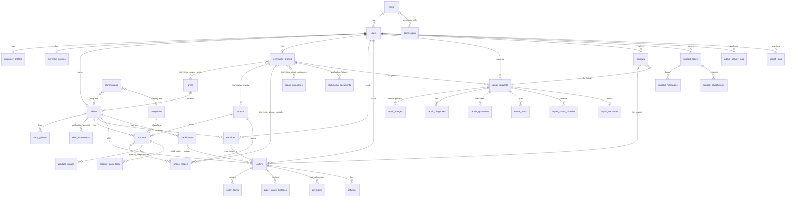

# Bhatkal Mobile Hub — System Architecture

## 1. Overview

Bhatkal Mobile Hub is a multi-merchant marketplace that connects customers, local mobile shops and repair technicians in Bhatkal, Karnataka. It is one Laravel application that serves:

* a versioned **REST API** (`/api/v1/*`), authenticated with **Laravel Sanctum** bearer tokens, and
* a **React single-page app** (Vite + Tailwind CSS 4, installable as a PWA). It contains four portals: Customer, Merchant, Technician and Admin.

```
            ┌──────────────── Browser / installed PWA ────────────────┐
            │  React SPA (react-router)                               │
            │  Customer  ·  Merchant  ·  Technician  ·  Admin portals │
            └───────────────┬─────────────────────────────────────────┘
                            │ HTTPS · JSON · Bearer token
┌───────────────────────────▼───────────────────────────────────────────┐
│ Laravel 13 (PHP 8.3)                                                  │
│  Middleware: auth:sanctum · active (suspension) · role:… · throttle   │
│  Controllers (thin) ──► FormRequests (validation) ──► Policies        │
│        │                                                             │
│        ▼                                                             │
│  Services (business rules, DB transactions)                          │
│   OrderService · RepairService · StockService · CommissionService    │
│   SettlementService · ReviewService · SupportService · SearchService │
│   ReportService · OtpService · Notifier · TemplateRenderer           │
│   WhatsAppLinkBuilder · AuditLogger · FileStore                      │
│        │                                                             │
│        ▼                                                             │
│  Eloquent models ──► MySQL 8 (SQLite in tests)                        │
│  Queue (database/Redis) · Scheduler · Storage (public + private disk) │
└───────────────────────────────────────────────────────────────────────┘
```

### Design principles

* **Thin controllers, rich services.** Every state change (order, repair, refund, settlement) goes through a service method. That method checks the allowed transition, runs inside a DB transaction, writes a status-history row and sends notifications.
* **Explicit workflows.** Orders and repairs are state machines (§5). An invalid transition throws `WorkflowException`, which returns HTTP 422 with a human-readable message.
* **Never assume consent.** An enquiry never becomes an order. An order request is not confirmed until the shop quotes, the customer accepts and the shop confirms. A repair cannot start without an approved quotation, and a changed quotation pauses the work until the customer approves it again.
* **Real data everywhere.** Every dashboard metric and report is computed from the database. There are no placeholder numbers.

## 2. Roles & permissions

Each user has exactly one role (`users.role` → `roles.name`). Roles map to permissions through `permission_role`. Route groups enforce the role with the `role:` middleware. Policies enforce ownership: a merchant can only see their own shop's orders, a technician only their assigned jobs, and a customer only their own records.

| Capability | Customer | Merchant | Technician | Support | Admin |
|---|:-:|:-:|:-:|:-:|:-:|
| Browse / search catalogue | ✓ | ✓ | ✓ | ✓ | ✓ |
| Enquiries, order requests, reviews | ✓ | | | | |
| Repair requests, approve quotations | ✓ | | | | |
| Raise support tickets | ✓ | ✓ | ✓ | | |
| Manage own shop, products, stock, orders | | ✓ | | | |
| Manage assigned repair jobs | | | ✓ | | |
| View all orders, repairs and users; handle tickets | | | | ✓ | ✓ |
| Verify shops and technicians; suspend users and listings | | | | | ✓ |
| Catalogue master data, reviews moderation | | | | | ✓ |
| Refunds, settlements, commission rules | | | | | ✓ |
| Templates, settings, reports, audit log | | | | | ✓ |

Authentication:
* **Customers, merchants and technicians** sign in with their mobile number and an OTP. OTPs are stored hashed, expire after 5 minutes and allow at most 5 attempts. There is a resend cooldown, and sending is rate-limited per phone and per IP.
* **Staff** (admin and support) sign in with email and a password (bcrypt). Staff accounts cannot use OTP login.
* Suspended accounts lose all tokens and are rejected by the `active` middleware.

## 3. Database (ER diagram)



The tables, grouped by migration:

| Migration | Tables |
|---|---|
| `0001_01_01_000000` | roles, permissions, permission_role, users, otp_codes, password_reset_tokens, sessions |
| `…000100_catalogue` | areas, categories, brands, phone_models, repair_categories |
| `…000200_profile_and_shop` | customer/merchant/technician profiles, shops, shop_photos, shop_documents, merchant_agreements, technician pivots, technician_documents, technician_agreements |
| `…000300_product` | products, product_images, product_compatibilities, product_stock_logs |
| `…000400_order` | enquiries, commissions, settlements, orders, order_items, order_status_histories, payments, refunds |
| `…000500_repair` | repair_requests, repair_images, repair_diagnoses, repair_quotations, repair_parts, repair_status_histories, repair_warranties |
| `…000600_operations` | reviews (polymorphic: shop / technician / product), support_tickets, support_messages, support_attachments, notifications, notification_templates, admin_activity_logs, search_logs, settings |

Notes:
* Money columns are `DECIMAL(10–12, 2)`. Orders snapshot `commission_type/rate/amount` and `merchant_payable` at confirmation, so a later change to a commission rule never changes historical orders.
* Every foreign key is constrained, and the hot paths are indexed: `(shop_id,status)`, `(customer_id,status)`, `(technician_profile_id,status)`, `products(category_id,status)`, `price`, `completed_at`, and the status columns.
* A polymorphic morph map stores short type names (`shop`, `technician`, `product`, …) instead of class names.
* The IMEI is stored in `repair_requests.imei_encrypted` using Laravel's `encrypted` cast, which uses the APP_KEY.
* Reviews are unique per `(customer, reviewable, order)` and per `(customer, reviewable, repair)`. The service layer enforces the same rule.

## 4. API structure (`/api/v1`)

Every response is JSON. Validation errors return `422` with an `errors` object, authorisation failures return `403`, and invalid workflow transitions return `422` with a `message`.

| Area | Endpoints |
|---|---|
| Public | `GET meta`, `GET home`, `GET search?q=`, `GET products` (filters: q, category, brand_id, phone_model_id, shop_id, area_id, min_price, max_price, availability, delivery, sort), `GET products/{slug}`, `GET shops`, `GET shops/{slug}`, `GET technicians` (repair_category, brand_id, area_id, pickup), `GET technicians/{slug}`, `GET phone-models?brand_id=` |
| Auth | `POST auth/otp/send`, `POST auth/otp/verify`, `POST auth/staff/login`, `GET auth/me`, `PUT auth/profile`, `POST auth/logout` |
| Common | `GET notifications`, `POST notifications/{id}/read`, `POST notifications/read-all`, `GET/POST tickets`, `GET tickets/{id}`, `POST tickets/{id}/messages`, private file streams (`repair-images/{id}`, `ticket-attachments/{id}`, `shop-documents/{id}`, `technician-documents/{id}`) |
| Customer | `GET/POST enquiries`; `GET/POST orders`, `GET orders/{id}`, `POST orders/{id}/accept · cancel · confirm-receipt · reviews`; `GET/POST repairs`, `GET repairs/{id}`, `POST repairs/{id}/quotation · handover · cancel · review` |
| Merchant (`/merchant`) | `GET/POST shop`, `POST shop/update`, `DELETE shop/photos/{id}`, `GET dashboard`, `GET/POST products`, `GET/POST/DELETE products/{id}`, `POST products/{id}/toggle · stock · confirm-stock`, `POST products/confirm-stock`, `GET products/{id}/stock-logs`, `DELETE products/{id}/images/{img}`, `GET enquiries`, `POST enquiries/{id}/reply`, `GET orders`, `GET orders/{id}`, `POST orders/{id}/quote · reject · confirm · ready · handover · cancel · payments`, `GET reports`, `GET settlements` |
| Technician (`/technician`) | `GET/POST profile`, `POST profile/update`, `GET dashboard`, `GET reports`, `GET repairs`, `GET repairs/{id}`, `POST repairs/{id}/accept · reject · diagnosis · quotation · start · progress · part · testing · test-result · complete · cancel` |
| Staff (`/admin`, admin + support) | `GET dashboard`, `GET tickets`, `GET tickets/staff`, `GET/PUT tickets/{id}`, `POST tickets/{id}/messages`, `GET orders`, `GET orders/{id}`, `GET repairs`, `GET repairs/{id}`, `GET users`, `GET users/{id}` |
| Admin only | `POST users/staff`, `POST users/{id}/suspend · activate`; `GET shops`, `GET shops/{id}`, `POST shops/{id}/status`; the same for `technicians`; `GET/POST taxonomy/{type}`, `PUT/DELETE taxonomy/{type}/{id}` (categories, brands, phone-models, areas, repair-categories); `GET products`, `POST products/{id}/moderate`; `POST orders/{id}/cancel · complete · adjust`; `POST repairs/{id}/cancel`; `GET reviews`, `POST reviews/{id}/moderate`; `GET/POST refunds`, `POST refunds/{id}/process`; `GET settlements`, `GET settlements/outstanding`, `POST settlements`, `GET/PUT settlements/{id}`; `commissions` CRUD; `notification-templates` CRUD + `preview`; `GET reports`; `GET/PUT settings`; `GET activity-logs`; `GET search-logs` |

## 5. Workflows

### 5.1 Order (shop purchase)

```
enquiry (optional, never an order) ──► requested ──quote──► quoted ──accept──► accepted ──confirm──► confirmed
                                          │  ▲ re-quote ┘        │                              (stock reserved,
                                          │                      └─decline──► cancelled          commission snapshot)
                                          └─reject──► rejected                                          │
confirmed ──ready──► ready ──handover──► handed_over ──customer confirms receipt──► completed ◄─────────┘
```

* **Shop** quotes the exact variant, colour, unit price and delivery fee, then confirms, marks the order ready, and marks it delivered or collected.
* **Customer** accepts the quotation and confirms receipt. Admin can complete an order on the customer's behalf, and this is logged.
* **Cancellation:** the customer can cancel before the shop confirms, the shop can cancel up to `ready`, and admin can cancel any open order. Stock reserved at confirmation is restored automatically.
* **Payments** (cash on delivery, payment at pickup, or a UPI reference) are recorded manually. The payment status becomes `paid` once the recorded total covers the order.

### 5.2 Repair

```
submitted ─accept─► accepted ─diagnosis─► diagnosing ─quotation─► quoted ─approve─► approved ─start─► in_progress
    │                                                     │  ▲                                          │   │
    └─reject─► rejected                          reject ─┘  └── revised quotation (reason required) ◄──┘   │
                                                quote_rejected                    work paused until re-approved
in_progress ─testing─► testing ─pass─► ready_for_handover ─customer checks device─► (handover confirmed)
                          └─fail─► in_progress                         ─technician completes─► completed
                                                                        (final bill = approved total, warranty issued)
```

* A quotation records the diagnosis, parts cost, labour cost, parts type (original, OEM-compatible, refurbished or aftermarket), total, estimated time, warranty days and warranty exclusions. Quotations are versioned. A pending quotation is superseded when it is replaced, and an approved quotation is superseded when a revision is approved.
* Completion requires either the customer's in-app handover check or the technician's declaration that the customer verified the device in person.
* **Privacy:** the customer's phone number and address are shown to the technician only after the job is accepted. The IMEI is optional and encrypted. The technician sees it only while an accepted job is open, and an admin can reveal it with the action audit-logged. Repair photos are stored privately and streamed only to authorised users.

### 5.3 Shop and technician onboarding

Register → status `pending` (hidden from customers) → admin approves (published) or rejects with a reason. After a rejection, editing the profile resubmits it. Admin can suspend and later reinstate, and every action is audit-logged and notified. Verification documents are stored on the private disk, and every time an admin views one it is logged.

### 5.4 Support tickets

A ticket is created with an acknowledgement deadline of **one business day** (Monday–Saturday). The categories fraud, safety concern, privacy violation and seller misconduct are **auto-escalated** (urgent priority, admins notified). The hourly `bmh:escalate-tickets` job escalates any ticket not acknowledged in time. The first staff reply or status change acknowledges the ticket. Staff can add internal notes that the customer never sees, and a ticket cannot be resolved without resolution notes.

### 5.5 Commission and settlements

* Rule precedence is **shop → category → global**. No rule means a free listing. Rules can be percentage, flat or free, and commission is calculated on the product amount only, excluding the delivery fee.
* `merchant_payable = total − commission + adjustments − processed refunds`
* A settlement groups completed orders that are not yet settled for one shop and period, and records gross, platform fee, adjustments, refunds and net payable. Admin marks a settlement as paid with a payment reference. **No funds move automatically.**

## 6. Search and discovery

`SearchService` searches with SQL `LIKE` across product name, description and SKU, brand, category, compatible model names, and shop name, with all words required. It supports the filters listed in §4 and sorting by relevance (available items first, then most recently confirmed stock), price, rating or newest. Queries are written to `search_logs` with their result counts. Zero-result queries appear in **Admin → Search insights** and in the reports, so the team can fill catalogue gaps. The empty state shows tips and popular categories.

*Phase 3:* move to MySQL FULLTEXT or Meilisearch through Laravel Scout. The service interface stays the same.

## 7. Notifications and WhatsApp

* In-app notifications are stored in the Laravel `notifications` table through the queued `PlatformNotification`. Selected events also send an SMS through the `SmsSender` interface. The default `LogSmsSender` writes to the log; for production, plug in a DLT-registered gateway.
* **WhatsApp click-to-chat** (`wa.me`) links are prefilled from admin-editable `notification_templates`, with built-in defaults as a fallback. These links only open WhatsApp on the user's device; they are **not** automated delivery. Automated WhatsApp messages need an approved WhatsApp Business provider (Phase 3).

## 8. Security

| Control | Implementation |
|---|---|
| Authentication | Sanctum bearer tokens. OTPs are hashed, expire, have limited attempts, a resend cooldown, and per-phone and per-IP rate limits. Staff passwords are bcrypt-hashed. |
| Authorisation | Role middleware, `EnsureActiveAccount`, Policies for orders, repairs, tickets and products, and ownership checks in every merchant and technician query. |
| CSRF | The API uses `Authorization: Bearer` tokens rather than cookies, so cross-site requests cannot carry credentials. Laravel's CSRF middleware still protects the `web` routes. |
| Validation | A FormRequest or `validate()` call on every write. Mass assignment is limited to validated keys. |
| Rate limiting | API 120/min per user, writes 30/min, OTP send and verify throttles, staff login 5/min. |
| Uploads | MIME and extension allow-lists, size limits and random file names. Public images go to the `public` disk. Documents, evidence and repair photos go to the private `local` disk and are streamed after authorisation checks. |
| Data protection | The IMEI is encrypted at rest and access is restricted and audited. Customer contact details are shared only with the counterparty, and only when needed. |
| Transactions | Every multi-step state change runs in a DB transaction, and stock rows are locked with `lockForUpdate`. |
| Audit | `admin_activity_logs` records verification, suspension, moderation, refund, settlement, commission, template, settings and document-view actions, with the IP and user agent. |
| Headers | `X-Content-Type-Options`, `X-Frame-Options`, `Referrer-Policy` and `Permissions-Policy`. |

## 9. Scheduled jobs

| Command | Schedule | Purpose |
|---|---|---|
| `bmh:escalate-tickets` | hourly | Escalate tickets not acknowledged within one business day |
| `bmh:stock-reminders` | daily 09:00 IST | Notify merchants about products with stale stock |
| `bmh:prune-otps` | daily | Delete expired OTP codes |
| `queue:prune-failed` | daily | Remove failed jobs older than 7 days |

## 10. Development milestones

| Phase | Scope | Status |
|---|---|---|
| **1 – MVP** | OTP auth, customer portal, shop registration and approval, merchant dashboard, product catalogue and stock, product search, repair discovery, repair requests and quotations, order workflow, WhatsApp click-to-chat, admin dashboard | **Implemented** |
| **2 – Marketplace operations** | Reviews and moderation, support tickets with SLA and escalation, commission rules, settlement tracking, refunds, reports for all roles, notification templates, stock history, audit logs, search insights | **Implemented** |
| **3 – Advanced** | Automated WhatsApp (Business API), payment gateway (Razorpay or Cashfree), automated settlements, delivery tracking, merchant subscriptions, POS integration, full-text search, recommendations, multi-city rollout | Planned. The extension points already exist: `SmsSender`, `TemplateRenderer` channels, `SearchService`, commission `type`, and city on `areas`. |
